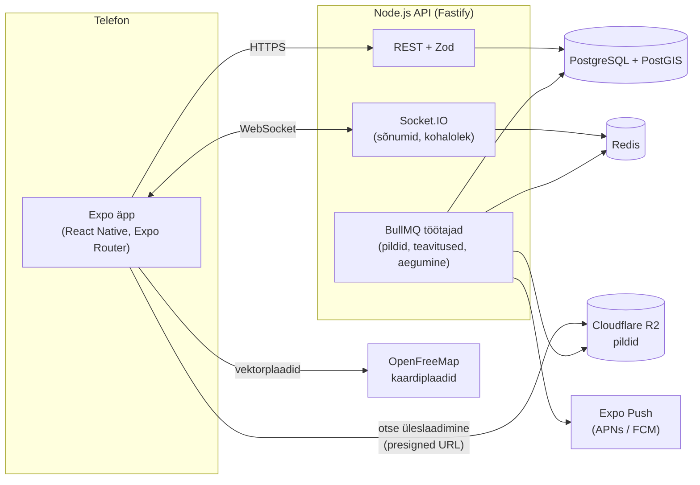

# 2. Arhitektuur



## Repositoorium (npm workspaces monorepo)

```
apps/
  mobile/        Expo äpp (src/app = vaated, src/components, src/lib/api.ts, src/constants/theme.ts)
  api/           Fastify API (src/modules/<valdkond>, src/http, src/db, drizzle/ migratsioonid, test/)
packages/
  shared/        Zod-skeemid, tüübid ja Figma disainitokenid — kasutavad mõlemad
docs/            uuring, arhitektuur, andmemudel, arendusplaan, disainisüsteem
```

API sisemine ülesehitus (kihid, nimed, vigade leping, turvalisus) on kirjas dokumendis [06-koodistandard.md](06-koodistandard.md).

## Põhimõtted

1. **Üks tõe allikas lepingutele.** Iga API sisend ja väljund on Zod-skeem `packages/shared`-is. Server valideerib, äpp kasutab tüüpe.
2. **Õigused serveris.** Äpp ei otsusta, mida kasutaja näha tohib. Tervisekirjed ainult omanikule; kohalolekut näevad vastavalt kasutaja seadele `presence_sharing` (`nobody` / `friends` / `everyone`); blokeeritud kasutajad ei näe teineteist.
3. **Pildid ei käi läbi API.** API annab ajutise üleslaadimislingi (presigned URL), äpp laeb pildi otse R2-sse, taustatöö teeb pisipildid. Andmebaasis on ainult võti (`*_key`).
4. **Kõik ajutine aegub serveris.** Kohalolek (`check_ins.expires_at`) lõpeb taustatööga, mitte äpi taha jätmisega.
5. **Asukoht on PostGIS-is.** `geometry(Point, 4326)` + GiST-indeks; kauguspäringud `ST_DWithin` / `ST_Distance` `geography` peal (meetrites).
6. **Disain ja kood kasutavad samu nimesid.** Figma muutujad → `packages/shared/src/tokens.ts` → `apps/mobile/src/constants/theme.ts`.

## Keskkonnad

| Keskkond | API | Andmebaas | Äpp |
|---|---|---|---|
| Arendus | `npm run dev:api` (localhost:3000) | Docker Compose | Expo Go / development build |
| Test (M8) | Railway / Render või Hetzner + Coolify (EL) | Hallatud Postgres + PostGIS | EAS Build → TestFlight, Play internal testing |
| Toodang | sama, eraldi projekt | eraldi andmebaas, igapäevased varukoopiad | App Store, Google Play, EAS Update |
