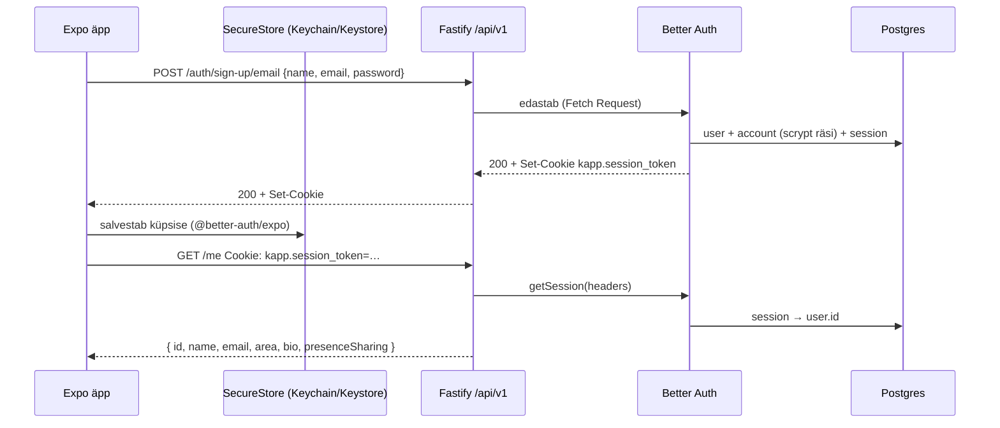

# 7. Autentimine (M1)

## Ülevaade

| Teema | Otsus | Põhjus |
|---|---|---|
| Teek | Better Auth 1.7 + `@better-auth/expo` | Paroolide räsimine (scrypt), sessioonide pööramine, OAuth state ja ID-tokenite kontroll on valmis ja auditeeritud; andmed jäävad meie Postgres'i. |
| Sessioon | HttpOnly küpsis `kapp.session_token`, 30 päeva, uuendatakse kord päevas | Telefoniäpp ei tohi kasutajat iga nädal välja logida; serveripoolne sessioon on tühistatav (erinevalt JWT-st). |
| Hoiustamine äpis | `expo-secure-store` | iOS Keychain / Android Keystore; AsyncStorage on krüpteerimata. |
| Parool | 8–128 märki, sama reegel serveris ja äpis | NIST soovitab pikkust keerukusreeglite asemel; ülemine piir kaitseb räsimise DoS-i eest. |
| Nimi | 2–60 märki, kontrollitakse ka serveris (`databaseHooks.user.create.before`) | Better Auth ise nime pikkust ei kontrolli. |
| Profiili muutmine | Ainult `PATCH /api/v1/me` (Zod, `.strict()`); Better Authi `/update-user` on välja lülitatud | Üks valideeritud tee; e-posti ega parooli ei saa muuta lihtsa profiiliuuendusega. |
| Lisaväljad | `area`, `bio`, `presenceSharing` on Better Authis `input: false` | Registreerimisel ei saa neid kaasa saata. |
| Vead | Kõik auth-vead tõlgitakse kujule `{ error: true, message }` (eesti keeles) | Äpp näitab sama lepingut kõigil endpoint'idel. |
| Parooli taastamine | Link kehtib 1 tund, kõik sessioonid tühistatakse; „Vaata oma postkasti" ei ütle, kas konto on olemas | Ei paljasta, millised e-postid on registreeritud. |
| Kiiruspiirang | Fastify: 30 päringut minutis `/auth/*` kohta IP-lt; Better Auth lisab oma rangemad reeglid sisselogimisele | Paroolide arvamise vastu. |
| E-posti kinnitus | Praegu välja lülitatud | E-posti teenus puudub (M8); muidu jääks iga uus kasutaja lukku. |

## Endpoint'id

| Meetod ja tee | Kes | Kirjeldus |
|---|---|---|
| `POST /api/v1/auth/sign-up/email` | kõik | Konto loomine, logib kohe sisse |
| `POST /api/v1/auth/sign-in/email` | kõik | Sisselogimine |
| `POST /api/v1/auth/sign-in/social` | kõik | Apple (ID token) või Google (suunamine) |
| `POST /api/v1/auth/sign-out` | sisselogitud | Tühistab sessiooni |
| `GET /api/v1/auth/get-session` | kõik | Kasutab äpi auth-klient |
| `POST /api/v1/auth/request-password-reset` | kõik | Saadab lingi (arenduses logisse) |
| `POST /api/v1/auth/reset-password` | lingiga | Uus parool |
| `GET /api/v1/me` | sisselogitud | Oma profiil |
| `PATCH /api/v1/me` | sisselogitud | `name`, `area`, `bio`, `presenceSharing` |

## Äpi vood

- `src/app/_layout.tsx`: `Stack.Protected` näitab sisselogimata kasutajale ainult gruppi `(auth)`, sisselogitule ainult äppi. Sisselogimise või väljalogimise järel ei navigeeri ükski vaade ise, juur vahetab vaated.
- `(auth)/welcome` → `sign-up` / `sign-in` → `reset-password` → `reset-sent`; e-posti link → `new-password?token=…`.
- `(tabs)/profile` → `profile-edit` (modaal).
- Vormid valideeritakse seadmes sama Zod-skeemiga (`packages/shared`), server kontrollib uuesti.

## Apple'i ja Google'i sisselogimise seadistamine

Kood on valmis, kuid nupud on peidetud, kuni võtmed on olemas. **Ilma võtmeteta ei ole neid testitud.**

### Sign in with Apple

1. Apple Developer Program (99 $ aastas) → Identifiers → App ID `ee.icd0018.kapp`, luba „Sign in with Apple".
2. Loo Services ID (veebi- ja redirect-voo jaoks) ja Sign in with Apple võti (.p8).
3. Genereeri `APPLE_CLIENT_SECRET` (JWT, kehtib kuni 6 kuud) võtmega .p8.
4. API `.env`: `APPLE_CLIENT_ID`, `APPLE_CLIENT_SECRET`, `APPLE_APP_BUNDLE_ID=ee.icd0018.kapp`.
5. Äpi `.env.local`: `EXPO_PUBLIC_AUTH_APPLE=true`.
6. **Expo Go-s töötab Apple'i sisselogimine Expo Go bundle ID-ga.** Päris testimiseks tee development build (`npx expo run:ios`), siis on token'i `aud` = `ee.icd0018.kapp`.
7. Apple saadab e-posti ainult esimesel sisselogimisel; Better Auth salvestab selle kohe.

### Google

1. Google Cloud Console → OAuth consent screen → OAuth client ID (Web application). Redirect URI: `<API_PUBLIC_URL>/api/v1/auth/callback/google`.
2. API `.env`: `GOOGLE_CLIENT_ID`, `GOOGLE_CLIENT_SECRET`; äpi `.env.local`: `EXPO_PUBLIC_AUTH_GOOGLE=true`.
3. Praegu kasutatakse brauseri suunamisvoogu (töötab Expo Go-s). Natiivne Google'i leht (`@react-native-google-signin`) vajab development build'i (M8).

## Teadaolevad piirangud

- E-kirju ei saadeta veel: parooli taastamise link ilmub API logisse (`password reset link (dev mailer — not sent)`). Toodangus on vaja Resend/Postmark teenust (M8).
- Konto kustutamine (GDPR) puudub — lisatakse enne avalikku väljalaset (App Store nõuab seda samuti).
- Onboardingu tutvustusvaated (Figma 02–03) jäid M7 viimistlusse.
